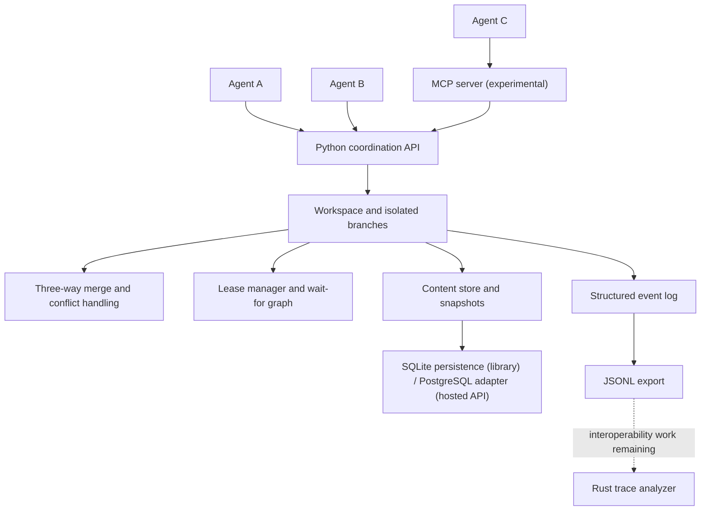

<div align="center">
    


# cerbere-cohort

**Shared state and conflict-aware coordination for multi-agent systems.**

Give agents isolated working branches, merge their changes without silently overwriting concurrent work, and keep a structured record of coordination decisions.

[](LICENSE)
[](python/)
[](crates/cerbere-cohort-trace/)

</div>

> **Early beta — not yet a distributed, multi-tenant production service.** The repository now includes a FastAPI service, PostgreSQL persistence, Supabase JWT authentication, persisted REST branch working copies, and a branch diff preview. The hosted API is deliberately single-organization and single-instance. MCP uses a separate branch registry and is limited to stdio when `DATABASE_URL` is configured. The Rust trace analyzer remains a prototype. APIs and event formats may change.

---

## Why this exists

Multiple agents working against the same mutable state can overwrite one another, duplicate work, or leave operators unable to explain how the final state was produced.

Most agent frameworks focus on defining agents and workflows. cerbere-cohort explores a narrower problem: **how independent agents share and update state without hiding conflicting changes**.

## What it provides

The current Python implementation uses a key-value workspace.

| Capability | Current behavior |
| --- | --- |
| Isolated branches | Each branch starts from a snapshot. Changes remain isolated until committed. |
| Three-way merge | A commit compares the branch with its base and the current workspace head. |
| Conflict detection | Divergent writes to the same key, including delete-versus-modify, are rejected rather than silently overwritten. |
| Conflict resolution | Optional resolver strategies can decide conflicting values. Decisions and rationale are recorded in events. |
| Content-addressed snapshots | JSON-compatible values are canonicalized and hashed; snapshot IDs include their content and parent history. |
| Replay | A workspace can be reconstructed from its event log and content store. Replay verifies reconstructed snapshot IDs. |
| Leases | Temporary resource leases support expiration, optional waiting, and ownership checks. |
| Deadlock detection | A wait-for graph detects cycles before an agent waits indefinitely. |
| SQLite persistence | `PersistentWorkspace` stores content objects, events, and active leases, then reconstructs state by replay on reload. |
| PostgreSQL persistence | The hosted API has a PostgreSQL persistence adapter; validate it against your own database before production use. |
| REST API | FastAPI exposes workspace state, branches, branch diffs, commits, conflict resolution, leases, events, and settings. |
| API authentication | Hosted PostgreSQL mode validates Supabase JWTs and checks membership in one configured organization. |
| MCP integration | An early stdio MCP server exposes workspace, branch, commit, lease, and event tools. Its branch registry is separate from REST. |
| Rust trace tool | An early CLI parses versioned JSONL events and reports basic counts and coordination metrics. |

cerbere-cohort is intended to sit alongside an agent framework. It does not create agents, schedule model calls, or execute agents' external tools. Its job is to coordinate shared state and make concurrent changes explicit.

## Quick start

### Requirements

- Python 3.10 or newer
- Rust stable, only if experimenting with the trace analyzer
- SQLite is included with supported Python builds; no separate database server is required for the local persistence layer

### Install the Python package

From the repository root:

```bash
python -m pip install -e "./python"
```

For development and tests:

```bash
python -m pip install -e "./python[dev]"
python -m pytest python/tests
```

### First example: conflicting writes

```python
from cerbere_cohort import ConflictError, Workspace

workspace = Workspace()
workspace.seed({"spec/auth": "initial"})

agent_a = workspace.create_branch("agent-a", "draft-a")
agent_b = workspace.create_branch("agent-b", "draft-b")

agent_a.set("spec/auth", "written by agent A")
agent_b.set("spec/auth", "written by agent B")

workspace.commit("agent-a", agent_a)

try:
    workspace.commit("agent-b", agent_b)
except ConflictError as exc:
    print("Conflict:", exc.conflicting_keys)

print(workspace.head.data)
# {"spec/auth": "written by agent A"}
```

The second commit is rejected because both branches changed the same key differently. The workspace head remains unchanged by the rejected commit.

### Disjoint changes merge

```python
from cerbere_cohort import Workspace

workspace = Workspace()
workspace.seed({"status": "new", "owner": "unassigned"})

agent_a = workspace.create_branch("agent-a", "update-status")
agent_b = workspace.create_branch("agent-b", "assign-owner")

agent_a.set("status", "in-progress")
agent_b.set("owner", "agent-b")

workspace.commit("agent-a", agent_a)
workspace.commit("agent-b", agent_b)

print(workspace.head.data)
# {"status": "in-progress", "owner": "agent-b"}
```

### Resolve a conflict explicitly

Resolvers are available from the `cerbere_cohort` package. For example, `PreferBranch`, `PreferHead`, and `PreferAgent` provide predefined strategies.

```python
from cerbere_cohort import PreferBranch, Workspace

workspace = Workspace()
workspace.seed({"config": "v1"})

a = workspace.create_branch("agent-a", "a")
b = workspace.create_branch("agent-b", "b")
a.set("config", "v2")
b.set("config", "v3")

workspace.commit("agent-a", a)
workspace.commit("agent-b", b, resolver=PreferBranch())

print(workspace.head.data)
```

A resolver is a policy choice, not proof that the resulting content is semantically correct. Review the selected strategy before using it in an application.

## Leases

Leases are advisory unless the workspace is created with `require_leases=True`. When enforcement is enabled, a branch write requires the acting agent to hold a lease for the key.

```python
from cerbere_cohort import LeaseError, Workspace

workspace = Workspace(require_leases=True)
branch = workspace.create_branch("agent-a", "change-schema")

try:
    branch.set("db/schema", {"version": 2})
except LeaseError:
    workspace.acquire_lease("agent-a", "db/schema", duration_seconds=60)
    branch.set("db/schema", {"version": 2})
```

Waiting for a lease and deadlock detection:

```python
workspace.acquire_lease("agent-a", "resource-a", duration_seconds=60)
workspace.acquire_lease(
    "agent-b",
    "resource-a",
    wait=True,
    timeout_seconds=5,
)
```

The second call waits for the resource to become available and raises an error on timeout. If the wait-for graph detects a cycle, it raises `DeadlockError`.

## SQLite persistence

The persistent wrapper is currently imported from its module rather than the package root:

```python
from cerbere_cohort.persistence import PersistentWorkspace

with PersistentWorkspace("workspace.db") as workspace:
    branch = workspace.create_branch("agent-a", "task-1")
    branch.set("task/status", "complete")
    workspace.commit("agent-a", branch)

    print(workspace.head.data)
    print(workspace.get_event_count())
    workspace.export_events_jsonl("events.jsonl")
```

On reopening the database, the workspace is reconstructed from the stored objects and event log. Replay validates object hashes and snapshot IDs.

**Operational note:** this persistence implementation is local SQLite storage. It is not a distributed database or a multi-host coordination service.

## Event log and trace tooling

The Python API exposes structured events through `Workspace.get_events()`. Each event currently contains:

- `schema_version` (`1.0.0`)
- `event_id`
- `timestamp`
- `agent_id`
- `action`
- `payload`
- optional `metadata`

The JSONL exporter writes one serialized event per line.

The Rust crate is named `cerbere-cohort-trace`:

```bash
cargo run -p cerbere-cohort-trace -- example-trace.jsonl
```

The Python event model, JSON Schema, sample JSONL log, and Rust parser now use the same `1.0.0` envelope. The Python reader and Rust parser also accept legacy records that omit `schema_version`, treating them as `1.0.0`. New events always serialize the version field. The current conflict metric is calculated as conflict events divided by successful plus aborted commit attempts. The analyzer remains an early prototype; run it against your own exported logs before depending on its metrics.

## Hosted REST API (early beta)

The repository also contains a FastAPI service for a hosted Cohort deployment. It is separate from the local Python-library quick start above.

Current route groups include:

| Route | Purpose |
| --- | --- |
| `GET /api/health` | Health check |
| `GET /api/overview` | Workspace overview |
| `GET /api/state` | Read shared workspace state |
| `GET /api/branches` | List branches |
| `POST /api/branches` | Create a branch |
| `GET /api/branches/{branch_id}/diff` | Preview proposed changes against the branch base and current HEAD |
| `PUT /api/branches/{branch_id}/state` | Update branch state |
| `POST /api/branches/{branch_id}/commit` | Attempt a branch commit |
| `GET /api/branches/{branch_id}/conflict` | Inspect branch conflicts |
| `POST /api/branches/{branch_id}/resolve` | Submit a conflict resolution |
| `GET/POST/DELETE /api/leases` | Inspect, acquire, and release leases |
| `GET /api/events` | Read coordination events |
| `GET /api/settings` | Read deployment settings |

Authenticated routes require a Supabase access token and enforce member or writer permissions. The health endpoint is public. In hosted PostgreSQL mode, the service is configured for one organization per deployment; this is **not** general multi-tenant isolation. The current API process is not a horizontally scalable, multi-instance coordination service.

The exact request and response schemas are defined in the FastAPI implementation and should be treated as authoritative. Interactive API documentation is available from FastAPI at `/docs` when the service is running.

## MCP server (experimental)

An early stdio MCP server is located in `integrations/mcp-server`. It exposes tools for reading workspace state, creating branches, writing to a branch, committing, acquiring and releasing leases, and reading events.

The server package declares the `cerbere-cohort-mcp` entry point. Install and run it from the integration directory after installing the local Python package:

```bash
python -m pip install -e "./python"
cd integrations/mcp-server
python -m pip install -e .
cerbere-cohort-mcp
```

The MCP server persists its workspace through SQLite or PostgreSQL and stores its own working branches in an `mcp_branches` table. **Those branches are separate from the REST API's `api_branches`; a branch created through REST is not visible to MCP and vice versa.** When `DATABASE_URL` is set, remote Streamable HTTP is deliberately rejected because authenticated remote MCP transport is not implemented. Use stdio for local MCP clients only. Do not expose this server publicly or treat it as a multi-user MCP service.

## Architecture



### Repository layout

```text
.
├── python/
│   ├── src/cerbere_cohort/          # Python coordination library
│   └── tests/               # Python test suite
├── crates/
│   └── cerbere-cohort-trace/        # Rust JSONL trace CLI (prototype)
├── integrations/
│   └── mcp-server/          # Experimental stdio MCP server
├── schemas/                 # Event schema draft
├── examples/                # Runnable examples
└── docs/                    # Design notes and concepts
```

## Current status and limitations

| Component | Status |
| --- | --- |
| Key-value workspace and isolated branches | Implemented; automated tests present |
| Three-way merge and conflict detection | Implemented; automated tests present |
| Resolver strategies and recorded decisions | Implemented; automated tests present |
| Content hashing and deterministic snapshot IDs | Implemented; automated tests present |
| Event-log replay and replay validation | Implemented; automated tests present |
| Leases and wait-for deadlock detection | Implemented; automated tests present |
| SQLite persistence and JSONL export | Implemented; automated tests present |
| PostgreSQL persistence adapter | Implemented in the hosted API; live production database validation is deployment-specific |
| FastAPI REST API and persisted REST branch registry | Implemented; single-organization, single-instance deployment only |
| Supabase JWT authentication and organization membership checks | Implemented for hosted PostgreSQL mode; not general multi-tenant isolation |
| Branch diff preview | Implemented at `GET /api/branches/{branch_id}/diff` |
| MCP stdio integration | Prototype; separate branch registry, not shared with REST |
| Rust trace analyzer | Prototype; versioned Python JSONL contract aligned |
| Versioned event schema (`1.0.0`) | Implemented; legacy records remain readable |
| Document-oriented workspace and distributed operation | Design work; not current behavior |
| Multiple organizations in one deployment | Not implemented; hosted API uses one configured organization |
| Multiple API processes or multi-host coordination | Not supported; deploy one API instance |
| Authenticated remote MCP transport | Not implemented; remote Streamable HTTP is rejected when `DATABASE_URL` is configured |
| Agent identity, external tool authorization, or sandboxing | Not provided |
| Semantic correctness of merged data | Not guaranteed |

The current workspace is **key-value based**, not a document-oriented file workspace. A conflict is detected at key granularity: two agents changing different parts of the same string value still conflict if they write different values to the same key.

## Design notes

See [docs/CONCEPTS.md](docs/CONCEPTS.md) for the intended semantics and open design questions. That document includes future directions that are not all implemented. Use the status table above and the source code as the reference for current behavior.

## Security and data handling

The hosted REST API authenticates human users with Supabase JWTs and checks their active membership in the configured organization. This applies to the hosted PostgreSQL API mode; it does not provide general multi-tenant isolation or agent-level identity. Cohort does not authorize agents' external tool calls or sandbox code. Local library and SQLite development usage do not provide an authenticated public API and must not be exposed to the internet.

Event payloads and stored values may contain application data. Do not place credentials, secrets, or sensitive production data in the workspace or event log unless your application applies appropriate redaction, access controls, and retention policies.

Please read [SECURITY.md](SECURITY.md) before reporting a vulnerability.

## Contributing

Contributions and concrete failure reports are welcome. Read [CONTRIBUTING.md](CONTRIBUTING.md) before opening a pull request. Reports describing the number of agents, shared state, operations, expected behavior, and observed failure are especially useful.

## License

MIT. See [LICENSE](LICENSE).
