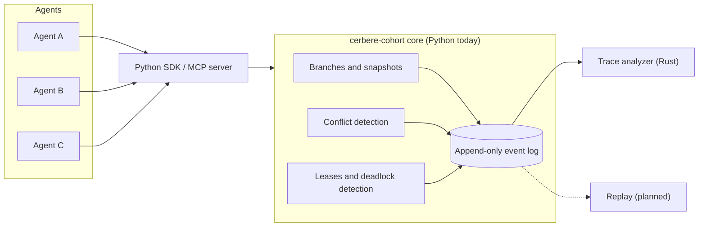

<div align="center">

# cerbere-cohort


**Shared state and coordination for multi-agent systems.**

Branches, conflict detection, leases and an append-only event log, so your agents stop overwriting each other.

[](LICENSE)
[](#status)
[](python/)
[](crates/cerbere-cohort-trace/)

</div>

> **Early development.** cerbere-cohort is an experimental prototype. The [Status](#status) table says exactly what works today and what does not. APIs and the event format will change.

---

## The problem

One agent writing to a codebase, a database or a document works fine. Put three of them on the same task and things start to break:

- Two agents edit the same thing and one silently erases the other's work.
- Agents duplicate effort, loop, or wait on each other forever.
- Something goes wrong and nobody can say **which agent changed what, when, and why**.

Agent frameworks help you *define* agents and workflows. Very little exists for what happens when several agents **share mutable state**. That is the gap cerbere-cohort explores.

## What cerbere-cohort is

A small, framework-agnostic coordination layer between your agents and the state they share:

| Idea | What it means |
| --- | --- |
| **Branches and snapshots** | Each agent works on an isolated copy of the shared state. Nothing is visible to others until commit. |
| **Conflict detection** | Commits are merged three-way, key by key. Concurrent edits that diverge are detected and refused, never silently overwritten. |
| **Leases and deadlock detection** | Agents can claim a resource for a bounded time. Circular waits raise an error instead of hanging. |
| **Append-only event log** | Every branch, commit, conflict and lease is recorded as a structured event, with the agent that caused it. |
| **Trace analysis** | A Rust tool computes coordination metrics (conflict rate, coordination overhead) from the event log. |

cerbere-cohort is designed to sit **alongside** your agent framework, not replace it.

## Quick look

```python
from cerbere-cohort import Workspace, ConflictError

ws = Workspace()
a = ws.create_branch("agent-a", "draft-a")
b = ws.create_branch("agent-b", "draft-b")

a.set("spec/auth", "draft written by A")
b.set("spec/auth", "draft written by B")

ws.commit("agent-a", a)          # fine
try:
    ws.commit("agent-b", b)      # same key, different content
except ConflictError as e:
    print(e.conflicting_keys)    # ['spec/auth']  (nothing was overwritten)

for event in ws.get_events():
    print(event.action, event.agent_id)
```

Leases are optional by default. To require an active lease before any write:

```python
ws = Workspace(require_leases=True)
ws.acquire_lease("agent-a", "db/schema", duration_seconds=60)
# wait=True blocks until free, and raises DeadlockError if waiting would form a cycle
ws.acquire_lease("agent-b", "db/schema", wait=True, timeout_seconds=5)
```

## Status

| Area | State |
| --- | --- |
| Workspace: branches, snapshots, three-way merge, conflict detection (key-value model) | **Prototype, tested** |
| Conflict, commit and branch events | **Prototype, tested** |
| Leases (advisory by default, enforceable) and deadlock detection | **Prototype, tested** |
| SQLite persistence and JSONL export | **Prototype, tested** |
| Rust trace analyzer (metrics from JSONL events) | **Prototype** |
| MCP server | **Draft, not yet covered by CI** |
| Document model with content-addressed snapshots | Planned ([design](docs/CONCEPTS.md)) |
| Deterministic replay | Planned |
| Pluggable resolvers and arbiter hook | Planned |
| Coordination benchmark | Planned |

Two things to know before you rely on it:

- The code today implements a **key-value** state model with random snapshot ids. [`docs/CONCEPTS.md`](docs/CONCEPTS.md) describes the target model (documents, content hashes, replay). Closing that gap is the current milestone.
- The event format is a **draft** (`schemas/event.v1.schema.json`) and has no `schema_version` field yet.

## Try it

Requirements: Python 3.10+. Rust (stable) only if you want the trace analyzer.

```bash
git clone https://github.com/chrismsmr-celcom/cerbere-cohort.git
cd cerbere-cohort

# Python: install, run the tests, run the demo
cd python
python -m pip install -e ".[dev]"
pytest
python ../examples/01_two_agents_conflict/run.py

# Rust trace analyzer (from the repository root)
cd ..
cargo run -p cerbere-cohort-trace -- example-trace.jsonl
```

You can export a real run with `PersistentWorkspace.export_events_jsonl("run.jsonl")` and feed it to the analyzer.

Event payloads may contain application data. Do not write secrets or sensitive production data to event logs without your own redaction and access controls.

## What cerbere-cohort is not

- **Not an agent framework.** It does not define your agents or workflows.
- **Not a model provider or adapter collection.**
- **Not a security boundary.** It does not enforce permissions or sandbox anything.
- **Not a hosted service.** It is a library and tools you run yourself.
- **Not a replacement for Git** where Git is enough. If your agents only edit files in a repository, a worktree per agent may be all you need. See [prior art](docs/CONCEPTS.md#10-prior-art-why-not-just-use-x).

## Architecture (design direction)



Principles: event-sourced, framework-agnostic, small core, honest measurement (we separate what is measured from what is assumed).

## Roadmap

Milestones are ordered, not dated.

- [x] **M0 Foundations**: package, tests, CI, first event schema draft.
- [ ] **M1 Conformance**: pass the seven acceptance criteria of [`docs/CONCEPTS.md` §13](docs/CONCEPTS.md), including replay with identical snapshot ids. Add `schema_version` to events.
- [ ] **M2 Resolution**: pluggable resolvers (rule, human, arbiter) with recorded decisions.
- [ ] **M3 Observability**: replay, richer metrics, a CLI trace viewer.
- [ ] **M4 Integrations**: stabilized MCP server, framework examples, a coordination benchmark.

Items may change based on testing and feedback.

## Help shape it

The most valuable contribution right now is **evidence**. If you run several agents against shared state, tell us what actually breaks:

- Open a [multi-agent failure report](https://github.com/chrismsmr-celcom/cerbere-cohort/issues/new?template=multi_agent_failure.yml): two agents clobbering each other, a deadlock, a run you could not reproduce.
- Challenge the design. If a piece of [`CONCEPTS.md`](docs/CONCEPTS.md) is wrong, say so.

Code contributions are welcome too. Please read [CONTRIBUTING.md](CONTRIBUTING.md) first.

## Security

cerbere-cohort is experimental software. Please read [SECURITY.md](SECURITY.md) before reporting a vulnerability or using it in a sensitive environment.

## License

MIT. See [LICENSE](LICENSE).
